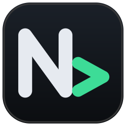

<h1 align="center">
    
    <p>NLR Shell</p>
</h1>
<p align="center">轻量、纯净、好用的 SSH 管理工具</p>

[](https://github.com/NLR-DevTeam/NLR-Shell/blob/main/LICENSE)


## 功能

- 支持快速输入`user@ip`连接服务器
- 支持查看服务器各项数据：
  1. 服务器基本信息
  2. CPU 运行状态，各个核心占用情况
  3. 内存利用率
  4. 网络状况（上传，下载占用）
  5. 磁盘占用
  6. 进程
- 方便的文件管理
- 多窗口管理，能够自由打开多个窗口执行执行工作
- 多项 UI 自定义选项

## 安装

下载 [Releases](https://github.com/NLR-DevTeam/NLR-Shell/releases) 中最新的版本即可运行

## 命令行启动参数

如果不带任何参数启动，程序会直接进入图形主界面。如果希望在脚本或终端中快速直达远程会话，可使用 `-connect`：

```sh
NLRShell -connect [user@]host[:port] [-identity 私钥文件] [-password 密码] [-passphrase 私钥口令]
```

- 该模式专为免交互设计：会自动接受并信任主机密钥
- 如果缺少认证凭据，命令将直接退出并报错

## MCP

NLR Shell 内置 [Model Context Protocol](https://modelcontextprotocol.io) 服务，可以让 Claude Code、Cursor 等 AI 助手通过一个本机 URL 使用你在 NLR Shell 中保存的服务器。

点击左上角 LOGO → **MCP 服务**：

- 打开「启用 MCP 服务」并保存，NLR Shell 运行期间会在 `http://127.0.0.1:14559/mcp` 提供服务（端口可修改）
- 顶部显示服务状态和地址，可以一键复制地址或重启服务
- 可以开启只读模式（不允许执行命令、写入和上传文件），设置是否自动信任首次连接的主机密钥，并选择 AI 可以访问的服务器（全部，或仅选中的服务器）

设置保存后立即生效，已连接的 AI 助手无需重启。

接入方式：在 AI 工具中添加 **Streamable HTTP**（有的工具叫「HTTP」）类型的 MCP 服务器，填入上面的地址。例如 Claude Code：

```sh
claude mcp add --transport http nlrshell http://127.0.0.1:14559/mcp
```

提供的工具：

| 工具 | 说明 |
| --- | --- |
| `list_servers` | 列出已保存的服务器（id、名称、分组、地址） |
| `run_command` | 执行命令，返回退出码、stdout、stderr（支持 `cwd`、`stdin`、超时） |
| `list_directory` | 列出远程目录 |
| `read_file` / `write_file` | 读取 / 写入（或追加）远程文本文件 |
| `upload_file` / `download_file` | 在本机与服务器之间传输文件 |
| `system_status` | 获取 CPU、内存、负载、网络、磁盘、进程等状态（同监控面板） |

说明：

- 服务只监听 `127.0.0.1`，其他电脑无法访问；需要 NLR Shell 保持运行。claude.ai 网页版等云端连接器无法访问本机地址。
- 为防止浏览器中的网页调用本机服务，服务只接受 `application/json` 请求，并拒绝来自其他网站（Origin）或其他主机名（Host）的请求。
- AI 只能使用已保存的连接，通过服务器 id 或名称指定；密码和私钥始终留在 NLR Shell 中，不会发送给 AI。
- 需要先在 NLR Shell 中连接一次并勾选「记住密码」（或保存私钥口令）；需要交互输入的认证方式无法通过 MCP 使用。
- 主机密钥发生变化时总是拒绝连接，请回到 NLR Shell 中确认。
- 连接在多次调用间复用，空闲 10 分钟后自动断开。
- `run_command` 以非交互方式（无 TTY）执行命令。AI 可以在允许的服务器上执行任意命令，请只接入你信任的 AI 工具，或开启只读模式。

## 源码构建

### Windows

推荐使用 PowerShell 运行随附脚本：

```powershell
.\build.ps1            # 编译 Release 版本
.\build.ps1 -Test      # 编译前执行单元测试
.\build.ps1 -Console   # 保留控制台窗口输出（便于排查故障）
```

### Linux

项目基于 Gio UI 开发。由于上游 Gio 目前在 Linux 下存在问题，仓库内附带了针对该问题的补丁（位于 `tools/giopatch`）。

**建议优先使用提供的构建脚本编译**。直接执行 `go build` 虽然也能成功，但会回退到未经打补丁的依赖，Linux 下将保留系统原生标题栏。

构建依赖 cgo 以及 X11 / Wayland 的系统开发库。请先安装编译依赖：

- **Arch Linux**:
  ```sh
  sudo pacman -S base-devel libx11 libxkbcommon libxkbcommon-x11 \
                 libxcursor libxfixes wayland libglvnd mesa
  ```
- **Debian / Ubuntu**:
  ```sh
  sudo apt install build-essential pkg-config libx11-dev \
                   libx11-xcb-dev libxcursor-dev libxfixes-dev libxkbcommon-dev \
                   libxkbcommon-x11-dev libwayland-dev libegl-dev libgles-dev
  ```

依赖就绪后运行：

```sh
./build.sh             # 编译产物为当前目录下的 ./NLRShell
./build.sh --test      # 编译前执行测试
```

## Linux 平台注意事项

- **配置路径**：配置文件存放在 `$XDG_CONFIG_HOME/nlrshell`（默认即 `~/.config/nlrshell`）。如果你需要便携模式，可以指定环境变量 `NLRSHELL_DATA` 来自定义路径（Windows 下路径默认为 `%APPDATA%\NLR Shell`）。
- **凭据安全**：Windows 下密码和密钥口令直接托管给 DPAPI；Linux 环境下，密码会保存在配置目录的 `secret.key` 中（文件权限自动设为 `0600`），并通过 XChaCha20-Poly1305 加密保存，请妥善保管该密钥文件。
- **SSH Agent**：Linux 下依赖 `SSH_AUTH_SOCK` 环境变量与系统的 `ssh-agent` 通信。
- **桌面环境兼容性**：目前界面在 KDE Plasma 环境下测试最为充分；在其他桌面环境（如 GNOME、XFCE 或各类平铺式 WM）下自绘窗体可能会有渲染细节差异。
- 如果缺少 Emoji字体请确保系统安装了Emoji字体：

  ```sh
  sudo apt install fonts-noto-color-emoji   # Debian / Ubuntu
  sudo pacman -S noto-fonts-emoji           # Arch Linux
  ```

## 支持

欢迎[提交问题/建议](https://github.com/NLR-DevTeam/NLR-Shell/issues)，[进群讨论](https://qm.qq.com/cgi-bin/qm/qr?k=3fydvbI64F7r0Tz2Y5BTWfJi-irnBnSz&authKey=ib%2FY0l5RwzWu2X5cDRK%2FB2swvZotR7f68BpJWLy5TuT1vRQGjya%2FT36dgV1xn4fs&noverify=0&group_code=182850795)
